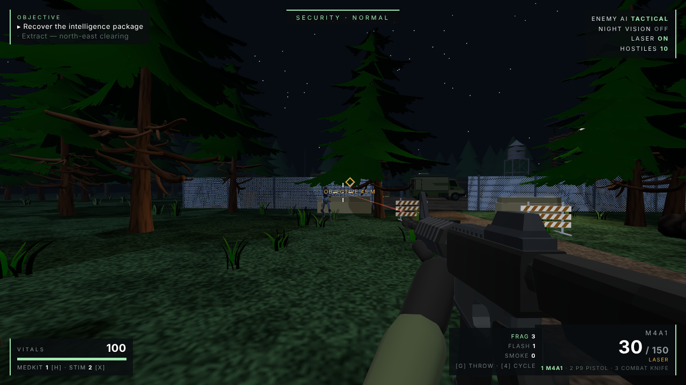
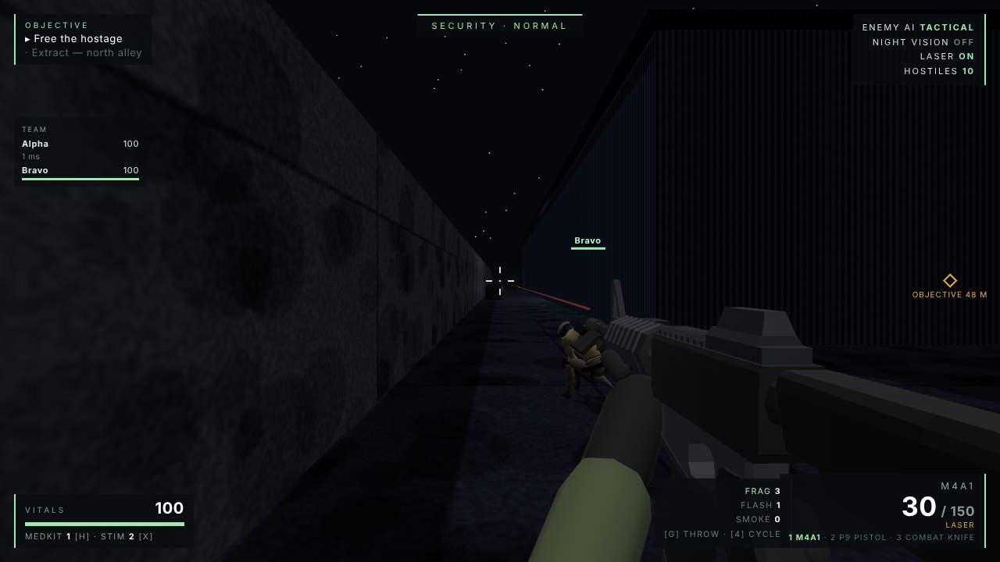

# SHADOW PROTOCOL

An experimental tactical first-person shooter that runs in the browser (Three.js / WebGL). Infiltrate a forest outpost
or an industrial warehouse at night, against guards who take cover, flank, radio in reports and run for the alarm.
Play generated missions solo, or in LAN co-op with 2–4 players total on your local network.



*Real frames from the running game, captured in headless Chromium with software WebGL. Above: solo, Forest Outpost.
Below: LAN co-op seen from the host, with teammate "Bravo" name-tagged and the TEAM panel.*



## Play solo

Download the latest release ZIP (or clone the repository) and open `index.html` in a desktop browser: Chrome, Edge or
Firefox. Nothing to install, no server, no internet connection needed. The game is pre-built in `dist/` with all
models embedded.

## Play LAN co-op (2–4 players)

1. On **one** computer (the host), in the game folder, run:

   ```bash
   npm run lan
   ```

   This needs [Node.js](https://nodejs.org) 18 or newer and no `npm install`. It prints addresses such as
   `http://192.168.1.20:8787/`.
2. On the host, open that address, then **MULTIPLAYER → CREATE PARTY**.
3. Friends on the **same Wi-Fi / LAN** open the host's network address, or the invitation link, on their own
   computers. They enter a name and the 5-character code, then press **JOIN PARTY**.
4. Everyone picks a loadout. The leader picks the mission and starts when everyone is ready.

Co-op runs entirely on your own network: there is no internet multiplayer service, account or cloud server. The
host's game runs the shared mission, so if the host leaves, the party ends. A copy of the game served over HTTPS
(such as an online solo demo) cannot join a LAN party; use the host's `http://` address. Full rules, architecture and
limitations: [`docs/MULTIPLAYER.md`](docs/MULTIPLAYER.md).

## Features

- **Missions:**
  - Intelligence Recovery, High-Value Target Capture, Sabotage, Hostage Rescue, and multi-stage operations
  - Quick, Standard or Extended length
  - Generated from a seed, with rotating objective zones, insertion and extraction, each validated as reachable
- **Maps:** Forest Outpost and Industrial Warehouse at night, plus a 100 m training range.
- **Enemy AI:** three profiles (Recruit, Tactical, Elite Squad). See the table below.
- **Security levels:** guards escalate from suspicious, to alert, to a lockdown with an alarm panel, and call finite
  reinforcements. Radio reports carry last known positions, never your live position. Sabotage cuts radio, alarm or
  power.
- **Shooting:**
  - One ballistic model for everyone; cover stops rounds, and rounds leave the muzzle
  - Four primaries, three secondaries and a knife
  - Red dot, holographic, 4x and 4–10x optics; suppressor, foregrip and laser
  - Frag, flash and smoke grenades; medkits and stims
- **Co-op (2–4):**
  - Shared enemies, objectives and security
  - Downed and revive, then killed in action and spectating
  - Extraction rules and identical team results
- **Feel and comfort:**
  - Raw, unsmoothed mouse look, with sensitivity matched through every aim and zoom transition
  - Frame-rate-independent movement
  - Comfort settings for camera motion and weapon sway
  - Graphics presets and adaptive resolution

| Enemy profile | Detection | Hearing | Reaction | Accuracy | Tactics |
|---|---|---|---|---|---|
| Recruit | slower (×0.75) | ×0.8 | 0.8–1.4 s | widest spread | rarely flanks; poor radio discipline |
| Tactical | ×1.0 | ×1.0 | 0.4–0.8 s | medium | lean-peeks, flanks, defends the objective |
| Elite Squad | ×1.1 | ×1.15 | 0.3–0.65 s | tightest | bounding moves, suppression, grenades |

Damage per hit is the same for every profile; they differ in perception, timing and tactics. All three use the same
fairness rules: no wallhacks, and no knowledge of where an unseen player is.

**The enemies are not an LLM.** Guard behaviour is hand-written game logic in `src/enemy.js` and `src/squad.js`:
perception, cover search, a squad coordinator and a state machine. The game never calls Claude or any other AI
service while it runs.

## How it was made

SHADOW PROTOCOL was implemented by **Claude**, Anthropic's AI model, through iterative prompting.

- **The first version:** the first playable version came from a single prompt.
- **Later iterations:** subsequent iterations added features (missions, equipment, AI tactics, training range, LAN
  co-op), refined the controls and gameplay, and fixed issues found in testing.
- **The repository owner's role:** they supplied the requests, played the game and gave feedback. They did not write
  the game's code.
- **Which models:** most of the work, including the initial implementation, was done with Claude "Fable"; later
  development continued with Claude "Opus".
- **The history:** each step is recorded in the commit history, and the historical progress reports in `docs/`.

## Verification and known limitations

Results for v2.4.1 (details in [`docs/MULTIPLAYER.md`](docs/MULTIPLAYER.md) and the release notes):

| Check | Result |
|---|---|
| `npm run build` | The bundle matches the committed `dist/game.js` |
| `npm test` (single-player suite) | 122 / 122 |
| `npm run servertest` (LAN server protocol and safety) | 18 / 18 |
| `npm run mptest` (co-op: real server, 2–4 browser contexts) | 31 / 31 |
| `npm run smoke` (real menu flow, all mission types and the range) | passed, no page errors |
| `npm run e2e` (real page, rendered-pixel checks, every map × mission × length played on foot) | E2E_RESULT |
| GitHub Actions CI on a clean runner | build check, servertest, test, mptest, smoke and an e2e sample all passed |

**How it was verified:** all of this is automated testing in headless Chromium, with software WebGL (SwiftShader),
on one machine. No manual play-testing, no real-GPU testing and no test across separate physical devices on a real
network were done. Co-op tests use several independent browser contexts on 127.0.0.1, and skip 3D rendering in those
tabs for speed; rendering is checked by the single-player end-to-end suite and by screenshots. Some tests place
players directly to stage situations, and the end-to-end walker is occasionally moved past tight spots (counted in
its report). A checklist for real devices is in [`docs/LAN_CHECKLIST.md`](docs/LAN_CHECKLIST.md).

**Known limitations:**

- **No host migration:** if the host leaves, the party ends.
- **Keep the host's game in the foreground:** browsers throttle background tabs, which slows the shared world.
- **No joining a mission in progress.**
- **Encounter size is not scaled** for larger parties.
- **Lag compensation is position-only.**
- **The maps are deliberately dark**, at night.

## Development

**Requirements:**

- **Playing solo:** only a browser.
- **Hosting LAN co-op:** Node 18 or newer.
- **Building and running the tests:** Node 22 or newer. `npm run servertest` uses Node's built-in WebSocket client.

Set up, then build:

```bash
npm ci
```

```bash
npx playwright install chromium
```

```bash
npm run build
```

`npm ci` installs esbuild, Playwright and the asset tools. `npx playwright install chromium` installs the browser the
tests drive; on Linux CI, add `--with-deps`. `npm run build` rebuilds `dist/game.js`, which is committed and must
match `src/`.

| Command | What it does |
|---|---|
| `npm test` | Single-player suite: missions, combat, AI, settings, loadouts, robustness |
| `npm run servertest` | LAN server protocol and safety checks |
| `npm run mptest` | Co-op through the real server with 2–4 browser contexts |
| `npm run smoke` | The real menu flow for every mission type |
| `npm run e2e` | The real page end to end: rendered-pixel checks and every map × mission × length played on foot (about an hour). `node tools/e2e.cjs <filter>` runs a subset. |
| `npm run lan` | Starts the LAN party server. `--port N` changes the port; `--public` removes the LAN-only address check and is not recommended. |
| `npm run assets` | Rebuilds `assets/*.glb` and `dist/assets.js` from the source packs (needs network access) |

GitHub Actions runs the build check and the suites on every pull request (`.github/workflows/ci.yml`).
`.github/workflows/pages.yml` publishes the static solo game to GitHub Pages once Pages is enabled with the source
"GitHub Actions".

**Controls:**

| Key | Action |
| --- | --- |
| W A S D / Mouse | Move / look |
| LMB / RMB | Fire / aim down sights |
| Mouse wheel | While aiming a variable scope: zoom 4–10x · otherwise: cycle grenades |
| Shift | Sprint · while scoped: hold breath |
| Space | Jump (hold against a low obstacle to climb it) |
| C (toggle) or Ctrl (hold) | Crouch |
| Q / F | Lean left / right |
| R | Reload |
| 1 / 2 / 3 | Primary / secondary / knife |
| V | Quick melee |
| G / 4 | Throw grenade / cycle frag, flash, smoke |
| H / X | Medkit / stim |
| E | Interact, pick up, revive a teammate (hold) |
| N / L | Night vision / laser sight |
| F3 | Performance overlay |
| Esc | Pause (in co-op the mission keeps running) |

Project notes: [`docs/MULTIPLAYER.md`](docs/MULTIPLAYER.md) is current. [`docs/CONTROLS.md`](docs/CONTROLS.md),
[`docs/SMOOTHNESS.md`](docs/SMOOTHNESS.md), [`docs/QA_V2_3_1.md`](docs/QA_V2_3_1.md), the `V2*_PROGRESS.md` logs and
[`GAME_PLAN.md`](GAME_PLAN.md) are historical records of earlier versions.

## Credits and license

- **3D models and animations: [Quaternius](https://quaternius.com)**
  - Universal Animation Library 1 & 2, Ultimate Guns, Stylized Nature and Zombie Apocalypse Kit
  - All released under **CC0 1.0**
  - Obtained from the mirror `github.com/series-ai/jam-ready-assets`
- **Generated in code:** world textures, audio, the UI, soldier equipment, optics and first-person hands.
- **Library:** [three.js](https://threejs.org) (MIT).
- **License:** the game's code is released under the [MIT License](LICENSE). The Quaternius assets remain CC0, and
  three.js keeps its own MIT license.
